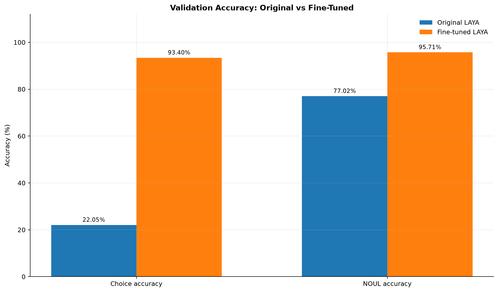
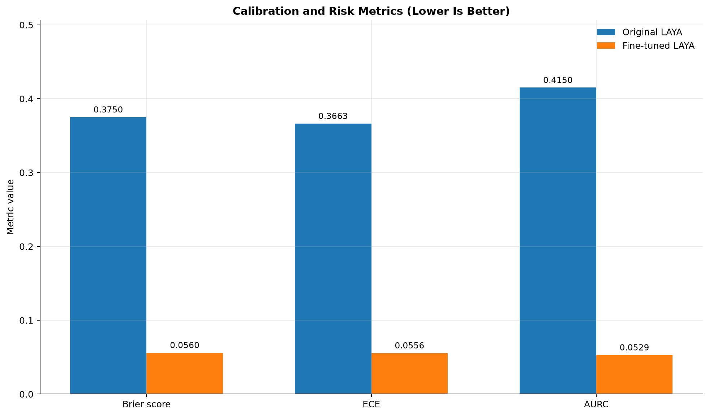

# Roman Urdu E-Commerce Sentiment Research: From Dataset to Fine-Tuned LAYA

> A reproducible research project documenting the collection, annotation, evaluation, and practical use of Roman Urdu e-commerce review sentiment data.

**Status:** Research prototype. Reported numbers below are project notes and should be regenerated from the released evaluation artifacts before being treated as final results.

## Overview

This project explores a practical pipeline for understanding Pakistani e-commerce reviews, including Roman Urdu and code-switched text. The work combines an existing Roman Urdu e-commerce dataset, a Qwen-assisted annotation workflow, curated train/test data, a fine-tuned LAYA checkpoint, and a small diagnostic comparison against LAYA outputs.

The long-term product direction is a website where a user pastes a product URL and sees comparable products from marketplaces such as Daraz, SHEIN, Alibaba, and AliExpress, with review-level sentiment summaries. That website is a planned application—not a claim that every marketplace integration is already implemented.

## Research journey

1. **Start from existing research data.** The project began with the Roman Urdu E-Commerce Dataset (RUECD), associated with the original author account [`bilalbaloch1`](https://github.com/bilalbaloch1/RU-BiSLTM). The upstream repository describes 26,824 Roman Urdu reviews with sentiment labels Positive (1), Negative (0), and Neutral (2). See [Dataset provenance and licensing](#dataset-provenance-and-licensing).
2. **Build a broader annotation workflow.** Candidate reviews were collected and prepared for annotation. The project notes mention a candidate pool of 32,689 unique records across several sources; this is a candidate-pool figure, not necessarily the final number of released or processed records.
3. **Use Qwen for assisted labeling.** Local Qwen inference was used as an annotation worker. The annotation instructions require labels to be grounded in the supplied review text and evidence spans to match the original text literally. Human review and validation remain important, especially for Roman Urdu, code-switching, sarcasm, and ambiguous sentiment.
4. **Prepare evaluation data.** Train, validation, and held-out test sets were created for the LAYA task. Keep the split definitions and IDs stable, and avoid using held-out test examples to tune prompts or training.
5. **Fine-tune and evaluate LAYA.** The project notes report a held-out test set of 2,503 examples and LAYA metrics of 93.50% `choice_accuracy` and 96.29% `noul_accuracy`. These are recorded project results; reproduce them using the exact checkpoint, evaluation code, and data before citing them as independently verified results.
6. **Run a small diagnostic audit.** A separate 100-review sample reported 100/100 IDs matched, 199/199 evidence spans matching literal substrings, 99% relevance, 93.9% sentiment, and 92% language. This is a small diagnostic sample, not a statistically definitive benchmark and not directly comparable to the held-out test metrics.
7. **Explore a product-comparison application.** The planned website would accept a product URL, find same or similar products across marketplaces, analyze available review comments with LAYA, and display comparable options. Marketplace access, scraping policies, API availability, and review licensing must be checked per source.

## Reported evaluation (provisional)

| Evaluation | Reported result | Interpretation |
|---|---:|---|
| LAYA held-out `choice_accuracy` | 93.50% | Project-reported test metric; regenerate from the pinned evaluation setup. |
| LAYA held-out `noul_accuracy` | 96.29% | Project-reported test metric; preserve the exact metric definition. |
| Held-out test size | 2,503 examples | From current project notes. |
| 100-review diagnostic ID match | 100/100 | Integrity check for that sample. |
| Diagnostic evidence spans | 199/199 literal matches | Span integrity check for that sample. |
| Diagnostic relevance | 99% | Small diagnostic sample only. |
| Diagnostic sentiment | 93.9% | Small diagnostic sample only. |
| Diagnostic language | 92% | Small diagnostic sample only. |
| Local LAYA throughput | ~71.3 examples/sec | Hardware- and configuration-dependent; report as a local benchmark, not a general speed claim. |

**Do not merge these metrics into one score.** They measure different tasks and samples. Include evaluation scripts, exact configuration, and machine-readable results alongside charts whenever possible. Charts generated by `make_laya_final_charts.py` should state which values are measured and which are estimates. In particular, any Qwen-versus-LAYA timing comparison described as a rough estimate must be labeled as such.

## Repository structure (recommended)

```text
.
├── README.md
├── DATASET_CARD.md
├── CITATION.cff
├── .gitignore
├── environment/
│   ├── laya-environment.yml
│   ├── laya-pip-freeze.txt
│   ├── pkreviews-environment.yml
│   └── pkreviews-pip-freeze.txt
├── docs/
│   ├── REPRODUCIBILITY.md
│   └── RESULTS.md
├── scripts/
│   └── make_laya_final_charts.py
├── figures/
│   └── (reproducible charts)
├── evaluation/
│   └── (metric outputs and configs; no private/raw data by default)
└── data/
    └── README.md  # explains access and provenance; data files added only after rights review
```

Adapt this to the actual files in the repository. Do not create placeholder results that look like measured results.

## Reproducing the environments

Export each Conda environment from the machine used for the experiment:

```bash
conda env export --no-builds -n laya > environment/laya-environment.yml
conda run -n laya python -m pip freeze > environment/laya-pip-freeze.txt

conda env export --no-builds -n pkreviews > environment/pkreviews-environment.yml
conda run -n pkreviews python -m pip freeze > environment/pkreviews-pip-freeze.txt
```

The Conda YAML records direct environment dependencies and channels; `pip freeze` supplements it with installed Python packages. Review exports for local paths, private indexes, credentials, or machine-specific entries before committing.

## Hardware and local inference notes

The development notes record two NVIDIA GeForce RTX 5070 Ti GPUs (16 GB each), 32 GB RAM, CUDA 13.0, and a local Qwen 3 14B Q4_K_M inference setup. Treat these as the environment used for the reported local experiments, not as required hardware. Record the exact driver, CUDA/runtime, model tag/digest, batch size, concurrency, and code revision for each reproducible benchmark.

Local inference endpoints were configured on loopback addresses. **Do not publish private endpoint credentials or expose a local inference service to the public internet.** Model checkpoints can be large and may have separate licensing terms; the default `.gitignore` excludes them.

## Dataset provenance and licensing

The upstream project is [`bilalbaloch1/RU-BiSLTM`](https://github.com/bilalbaloch1/RU-BiSLTM), whose README describes RUECD as 26,824 Roman Urdu reviews and explains the original label mapping. Attribute the original creator and cite the upstream project in any derivative publication.

Before redistributing the original dataset or derived review text, verify the exact Hugging Face dataset repository, revision, license, and any terms applying to the original reviews. A public download is not automatically permission to redistribute. If permission is unclear, publish a dataset card, transformation scripts, split IDs where lawful, and instructions for obtaining data from the original source rather than committing raw review text.

## Responsible use and limitations

- Roman Urdu spelling varies widely; transliteration and code-switching can confuse language detection and sentiment models.
- Sentiment labels are subjective, particularly for mixed or sarcastic reviews.
- A small diagnostic sample is useful for finding implementation bugs but cannot establish broad model quality.
- Marketplace pages, review text, prices, and images may be protected by terms of service or copyright. Use official APIs or permitted access paths and honor rate limits.
- Do not expose user credentials, cookies, private customer information, local databases, model endpoints, or unrestricted model weights in a public repository.
- If publishing data, check privacy, consent, licensing, and removal obligations first.

## Citation

See [`CITATION.cff`](CITATION.cff) for a starter citation file. Replace placeholder fields with the final repository URL, author list, and release date before tagging a release.

## Current state

This repository template is intended to document the work transparently. Before public release, populate it with the real code, charts, evaluation configs, and environment exports; verify every metric; and complete the data/model license review. No claim is made here that a public repository has already been created or that the full pipeline is production-ready.

## LAYA Fine-Tuning Results

### Metric Improvements


### Training Loss


See the [evaluation report](evaluation/roman_urdu_100_v1/analysis_report/REPORT.md)
for evaluation metrics and limitations. The 100-record evaluation uses
silver labels that have not been independently verified by human annotators.

### Before vs. After Fine-Tuning



### Calibration and Risk


